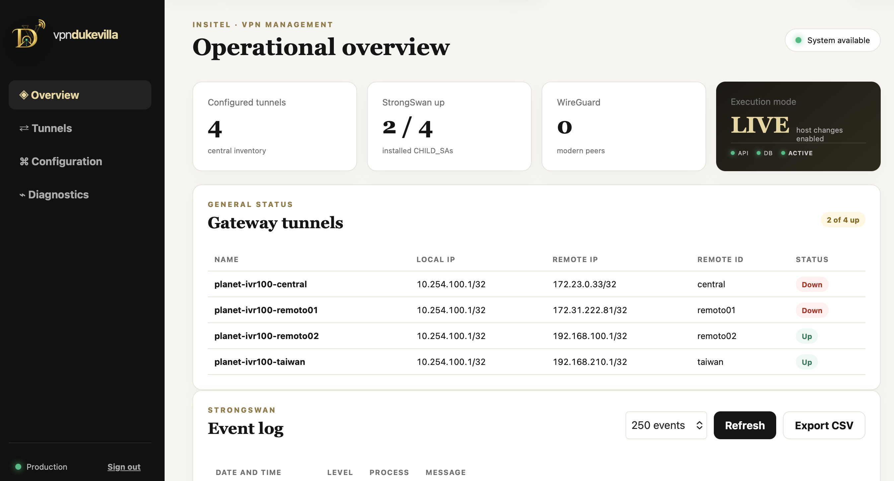
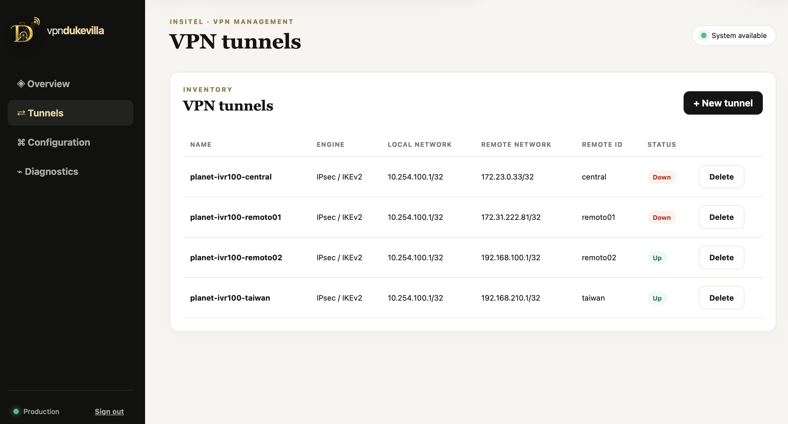
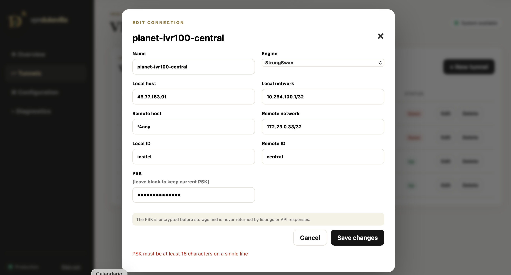
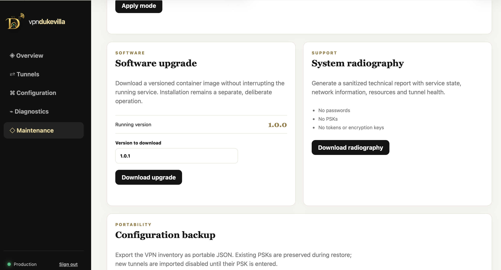

[Download the official PDF manual](/downloads/vpndukevilla/VPNdukevilla_User_Manual_v1.0.4.pdf)

**PRODUCT MANUAL**

# VPNdukevilla

Control plane for StrongSwan and WireGuard · User and operations guide

| Publisher | DukeVilla |
| --- | --- |
| Document version | 1.0.4 |
| Release date | October 19, 2026 |
| Classification | Product documentation |

*Operations document. It contains no passwords, PSKs, SNMP community strings, or private keys.*

## Document control

| Field | Contents |
| --- | --- |
| Purpose | Provide a reusable description of every menu, field, administrative workflow, execution mode, integration, diagnostic, backup, and maintenance function in VPNdukevilla 1.0.4. |
| Version | 1.0.4 |
| Status | Ready for release |
| Publisher | DukeVilla |
| Intended audience | VPN administrators and operators |
| Audience | Administrators and operators. Credentials and secrets are delivered through a separate secure channel. |

### Security notice

| IMPORTANT | This manual describes procedures and reference values, but deliberately omits passwords, PSKs, SNMP community strings, tokens, and keys. Do not copy secrets into tickets, email, or screenshots. Rotate any secret that may have been exposed. |
| --- | --- |

## Contents

| Section | Topic |
| --- | --- |
| 1 | Description and scope |
| 2 | Architecture and security |
| 3 | Sign-in and roles |
| 4 | Overview |
| 5 | Tunnels |
| 6 | Editing tunnels |
| 7 | Configuration and Integrations |
| 8 | Diagnostics |
| 9 | Maintenance |
| 10 | DRY RUN and LIVE modes |
| 11 | Apply and rollback |
| 12 | Backup and restore |
| 13 | Updates |
| 14 | Operations and escalation |
| 15 | Appendices |

## Description and scope

VPNdukevilla is a web control interface for inventorying, generating, applying, and verifying VPN configurations. In version 1.0.4, StrongSwan is operational and WireGuard is prepared for a later release. This version adds managed Docker application integrations and a signed updater with backup and transactional rollback.

| Capability | Version 1.0.4 |
| --- | --- |
| Tunnel inventory | Yes |
| StrongSwan / IKEv2 | Yes |
| WireGuard | Inventory and preparation; activation in a later release |
| CHILD_SA status | Yes, read from the host |
| Ping / traceroute | Yes, through the host agent |
| Events / CSV | Yes |
| admin and view users | Yes |
| Secret-free backup | Yes |
| Sanitized system radiography | Yes |
| Checking for updates | Signed channel: download, deliberate installation, health check, and automatic rollback |
| Automatic updates | Staged download; deliberate activation by an administrator |
| Application integrations | LibreNMS, Facil IoT, and traDUKtor with automatic detection |

## Architecture and security

| Component | Privilege | Function |
| --- | --- | --- |
| Web container | No Linux capabilities | UI, API, users, inventory, and PSK encryption. |
| SQLite /data | Persistent | Users, tunnels, execution mode, and encrypted PSKs. |
| Host agent | Privileged and local | Diagnostics, atomic writes, restart, verification, and rollback. |
| Unix socket | Local and authenticated | Web-to-agent channel; it is not exposed on the network. |
| StrongSwan | Host | IKEv2/IPsec negotiation. |
| Protected loopback | Host | Maintains 10.254.100.1/32 as the local management selector. |

- The PSK is encrypted before it is stored.

- The API and listings never return the PSK.

- The preview masks secrets.

- The web container does not modify the host directly.

- Each apply operation creates a backup and rolls back if validation fails.

- Do not publish the .env file, database, or keys in Git or in the container image.

## Sign-in and roles

| Role | Permissions |
| --- | --- |
| admin | Create, edit, and delete tunnels; apply configurations; change mode; manage accounts; create backups and radiographies; install upgrades. |
| view | View Overview, Tunnels, events, previews, and diagnostics. Cannot modify the inventory or host. |

1. Open the URL provided by the administrator.

2. Enter your username and password.

3. Change the initial password under Configuration.

4. Sign out when finished, especially on shared workstations.

| IMPORTANT | Initial credentials are not published in this manual. They are delivered through a separate secure channel and must be changed at first sign-in. |
| --- | --- |

## Overview

*Figure 1. Overview with operational summary, tunnel status, and events.*

| Item | Interpretation |
| --- | --- |
| Configured tunnels | Number of connections stored in the inventory. |
| StrongSwan up | Installed CHILD_SAs / configured StrongSwan tunnels. |
| WireGuard | Inventoried WireGuard peers. |
| Execution mode | DRY RUN or LIVE, together with API, database, and agent health. |
| Gateway tunnels | Compact summary with name, selectors, Remote ID, and status. |
| Event log | StrongSwan events; initially collapsed, with Refresh and Export CSV controls. |

| IMPORTANT | Up means that a CHILD_SA is installed. To confirm end-to-end service, also ping the protected IP address. |
| --- | --- |

## Tunnels

*Figure 2. Tunnel inventory.*

| Column / action | Description |
| --- | --- |
| Name | Unique administrative identifier. |
| Engine | StrongSwan or WireGuard. |
| Local network | Local protected selector. |
| Remote network | Remote protected selector. |
| Remote ID | Expected IKE identity of the peer. |
| Status | Up, Down, or Not applied. |
| + New tunnel | Opens the new tunnel form. |
| Edit | Allows fields to be edited and the PSK to be changed if required. |
| Delete | Deletes the record from inventory; confirmation and Apply are required to update the host. |

### Creating a tunnel

1. Select + New tunnel.

2. Complete every field according to the addressing plan.

3. Enter a strong, unique PSK delivered through a secure channel.

4. Select Save tunnel.

5. Open Configuration → Preview and review the generated configuration.

6. In LIVE mode, select Apply to materialize the inventory in StrongSwan.

7. Restart or activate the remote IPsec connection if the peer does not renegotiate automatically.

8. Confirm an Up state and run a ping to the protected address.

## Editing tunnels

*Figure 3. StrongSwan connection edit form.*

| Field | Rule | Example |
| --- | --- | --- |
| Name | Unique, stable, lowercase letters and hyphens | ipsec-remote03 |
| Engine | StrongSwan in production version 1.0.4 | StrongSwan |
| Local host | Public IP or gateway listening address | Address assigned to the server |
| Local network | Local protected selector in CIDR notation | 10.254.100.1/32 |
| Remote host | %any for peers with dynamic IP addresses | %any |
| Remote network | Remote protected network in CIDR notation | 192.0.2.10/32 |
| Local ID | Identity presented by the gateway | gateway |
| Remote ID | Exact identity configured on the remote IPsec peer | remoto03 |
| PSK | At least 16 characters on a single line | Secret delivered through a separate secure channel |

### Saving changes

- Save changes updates the inventory.

- Leaving the PSK field blank preserves the current PSK.

- Entering a new PSK replaces the current value and stores it encrypted.

- Saving is not the same as applying: review the preview and run Apply.

## Configuration and Integrations

| Item | Purpose |
| --- | --- |
| StrongSwan Preview | Displays ipsec.conf and ipsec.secrets with PSKs masked. |
| StrongSwan Apply | Sends inventory to the agent, validates, backs up, writes, restarts, verifies, and rolls back on failure. |
| WireGuard Preview | Generates the proposed configuration. |
| WireGuard Generate | Reserved for future WireGuard support. |
| Admin account | Changes the administrator username and password. |
| View account | Enables or disables the view account and sets its password. |
| LibreNMS | Enables monitoring, polling, syslog, and availability tests across protected networks. |
| Facil IoT | Enables access from detected Facil IoT containers to protected networks. |
| traDUKtor | Enables access from detected traDUKtor containers to protected networks. |
| Detected / Not detected | Indicates whether VPNdukevilla found compatible containers for the integration. |
| Apply integrations | Discovers containers and idempotently reconciles forwarding and source NAT rules. |

| IMPORTANT | Apply with no changes must be idempotent: it verifies state without changing the functional result. If an error appears, do not retry blindly; read the message and system radiography. |
| --- | --- |

## Diagnostics

| Field | Purpose |
| --- | --- |
| Target | IP address or hostname to test. For IPsec validation, use an address inside the protected remote network. |
| Ping | Checks reachability and latency. |
| Traceroute | Displays hops to the destination; traceroute must be installed on the host. |
| Run | Requests the host agent to run the test and returns its output. |

### Interpretation

- Tunnel Up + successful ping: control plane and data plane are operational.

- Tunnel Up + failed ping: check selectors, firewall rules, protected IP, and ICMP.

- Tunnel Down + incoming IKE traffic: check IDs, PSK, proposals, and the CHILD_SA.

- No IKE traffic: check the peer, public IP, intermediate firewall, and UDP ports 500 and 4500.

## Maintenance

*Figure 4. Maintenance page with execution mode, version, system radiography, and backup.*

| Tool | What it does | What it does not do |
| --- | --- | --- |
| Execution mode | Selects DRY RUN or LIVE and requires Apply mode | Does not automatically apply tunnel configurations. |
| Check latest version | Queries the official signed channel, compares versions, and allows a newer release to be downloaded and verified. | Does not replace the running service until an administrator confirms Install update. |
| Install update | Installs the previously downloaded signed package, creates a backup, recreates the console, and performs a health check. | Is unavailable without a valid package; if the health check fails, it automatically restores the previous version. |
| System radiography | Downloads sanitized JSON containing service, network, resource, and tunnel health | Does not include secrets. |
| Download backup | Exports the inventory as portable JSON | Does not include PSKs, passwords, tokens, or keys. |
| Load backup | Merges a backup into the current inventory | Does not generate PSKs; new tunnels remain disabled. |

## DRY RUN and LIVE modes

| Mode | Effect |
| --- | --- |
| DRY RUN | Allows inventory, previews, reports, and backups. Blocks diagnostics and actual host changes. |
| LIVE | Enables diagnostics and actual changes through the host agent. |

1. Select the required mode.

2. Review the on-screen explanation.

3. Select Apply mode.

4. Confirm on Overview that the mode and agent status are consistent.

| IMPORTANT | A new installation should remain in DRY RUN until it reaches its final location, receives its production addressing, and enters an approved migration window. |
| --- | --- |

## Apply and rollback

### Transactional workflow

1. The application validates fields and PSKs.

2. The agent creates a backup of the active configuration.

3. It generates temporary files with restrictive permissions.

4. It validates the syntax.

5. It atomically replaces the StrongSwan files.

6. It restarts the service.

7. It runs statusall and verifies that the inventory was loaded.

8. If validation fails, it restores the backup and returns an explicit error.

| Message | Meaning | Action |
| --- | --- | --- |
| Host agent is unavailable | The UI could not contact the socket or agent | Check the service, socket, and permissions. |
| Apply failed; backup was restored | Validation or verification failed and the change was rolled back | Download a radiography and inspect the agent and StrongSwan. |
| statusall returned non-zero | StrongSwan did not report a healthy state | Check the service, plugins, and configuration before retrying. |
| Not applied | Inventory not materialized or DRY RUN active | Change to LIVE only during an approved maintenance window, then apply. |

## Backup and restore

### Exporting a backup

1. Open Maintenance.

2. Select Download backup.

3. Store the JSON file in a secure repository with its date and version.

4. Confirm that the file opens and contains no secrets.

### Restoring a backup

1. Back up the current state.

2. Select Load backup and choose the JSON file.

3. Review the summary of created and updated records.

4. Enter the PSKs for new connections.

5. Review Preview.

6. Apply in LIVE mode during an approved maintenance window.

| IMPORTANT | A secret-free backup does not replace an encrypted database backup. For a complete migration, the database and PSK_ENCRYPTION_KEY must remain consistent and must be safeguarded separately. |
| --- | --- |

## Updates

### Checking for updates

1. Select Check latest version.

2. If the versions match, the application reports that it is current and makes no changes.

3. If a newer version is available, review the proposed version and confirm the signed download.

4. Wait for hash and signature validation. The version is staged and Install update becomes available.

5. Download a backup and system radiography; during a maintenance window, select Install update and confirm.

6. The console restarts briefly and verifies that the new version is healthy.

7. Confirm the version, mode, agent, integrations, and tunnels. If the health check fails, the host restores the backup.

For the first field update, use a controlled maintenance window and retain administrative host access until verification is complete.

| Principle | Recommendation |
| --- | --- |
| Versioning | Use immutable tags such as 1.0.4; do not use latest in production. |
| Image | Distribute the container image; source code does not need to be copied to the customer host. |
| Data | Keep /data persistent and backed up. |
| Rollback | Retain the previous image and a database backup. |
| Official channel | https://vpn.duke-villa.com/api/releases/latest |
| Automation | Check latest version downloads and verifies; Install update deliberately activates the release with backup, health check, and rollback. |

## Operations and escalation

| Frequency | Activity |
| --- | --- |
| Daily | Review Overview, Down tunnels, and recent events. |
| When creating or editing | Save → Preview → Apply → Up → ping. |
| Weekly | Export CSV if flapping occurs and review disk space and services. |
| Monthly | Create a configuration backup and system radiography. |
| Before an upgrade | Confirm the backup, radiography, version, and maintenance window. |
| After restart | Confirm the container, agent, StrongSwan, protected loopback, and tunnels. |

### Minimum support information

- Installed version and execution mode.

- Date, time, and affected tunnel.

- Up, Down, or Not applied state.

- Ping and traceroute results.

- Relevant IKE event with no PSK or secret data.

- Sanitized system radiography.

- Most recent change and Apply result.

## Appendices

### Standardized IPsec peer template

| Parameter | Baseline value |
| --- | --- |
| Role | Initiator |
| Remote host | Gateway public IP |
| Local network | Local protected network in CIDR notation |
| Remote network | 10.10.0.0/24 |
| Local ID | Unique gateway identity |
| Remote ID | Unique remote peer identity |
| IKE | v2 |
| Phase 1 | AES-256 / SHA2-256 / DH14 |
| IKE lifetime | 3 hours |
| Phase 2 | AES-256 / SHA2-256 / PFS |
| ESP lifetime | 1 hour |
| DPD | 30 s / timeout 150 s / Restart |

### Provisioning checklist

- Unique ID and protected network.

- Strong, unique PSK.

- Inventory saved.

- Preview verified.

- Apply completed successfully.

- CHILD_SA Up.

- Protected-address ping successful.

- Device added to LibreNMS.

- Syslog received.

- Documentation updated.
